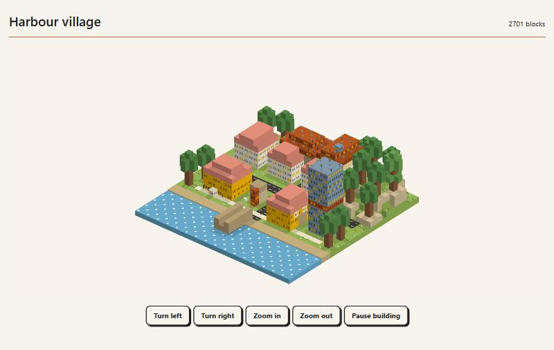

# Voxel Genesis



Build a voxel world with an agent through four local tools.
Worlds grow in place up to 160 by 160 blocks and 64 high.
Watch the town take shape in a browser on your machine.
How to build one: docs/BUILDING-A-WORLD.md.

## Start in 60 seconds

Have Node 20 or newer. Clone or copy this folder, then open a terminal here.
No package installation or build step is needed.

```sh
git clone https://github.com/AAPOFoundation/voxel-genesis.git
cd voxel-genesis
node bin/voxel-genesis.mjs serve
```

Open the printed viewer link. Keep the serving terminal open while you build.
In a second terminal here, run the example and watch it arrive:

```sh
node bin/voxel-genesis.mjs run fixtures/small-town.json
```

The command prints the completed town's block count.

## Connect from npm

[//]: # (COPY-DRAFT)

No clone is needed. Each client starts the server with the same command.

```sh
npx -y voxel-genesis mcp
```

Claude Code, from any project folder:

```sh
claude mcp add voxel-genesis -- npx -y voxel-genesis mcp
```

The Claude desktop app, Cursor and most other clients read this JSON shape:

```jsonc
{
  "mcpServers": {
    "voxel-genesis": { "command": "npx", "args": ["-y", "voxel-genesis", "mcp"] }
  }
}
```

Codex reads the same entry as TOML in its config file:

```toml
[mcp_servers.voxel-genesis]
command = "npx"
args = ["-y", "voxel-genesis", "mcp"]
```

On Windows, use this entry for clients that cannot start npx directly:

```jsonc
{ "command": "cmd", "args": ["/c", "npx", "-y", "voxel-genesis", "mcp"] }
```

Any other MCP client works with a stdio server entry that runs the same command.
Saves stay in the folder named under Privacy, whichever way the server starts.

## Claude Code desktop app and CLI

Run this here, then open this folder in Claude Code:

```sh
node bin/voxel-genesis.mjs connect claude
```

For another project, run from that folder using the connector's full path.
On Windows, quote the full path if it contains spaces.
The command adds the voxel-genesis entry to that project's .mcp.json and preserves other servers.
It uses the current Node executable and the absolute connector path.
Open the same project in the desktop app or CLI and start a new session there.
A session reads .mcp.json only when it starts, so one that was already open will not have the tools.
Approve the local server if Claude Code asks.

The desktop app's Connectors menu lists account connectors only. This local server never appears
there, and nothing needs ticking. To confirm it loaded, ask "Which voxel-genesis tools do you have?"
The answer should name world_open, world_build, world_look and world_undo.
In the CLI, /mcp lists voxel-genesis as connected.

Ask for a world and open the viewer URL from the first tool reply.
MCP starts its own viewer. Use its reply link; serve is only needed for CLI use.

[//]: # (COPY-DRAFT)

[Example prompt](src/copy.mjs):
"Build a small town with three cottages, a shop, trees and a yellow car."

## Grok

For a Grok client that reads project MCP configuration:

```sh
node bin/voxel-genesis.mjs connect grok
```

This updates [mcp_servers.voxel-genesis] in the current project's .grok/config.toml.

Grok starts a project server only in a folder you have trusted. To check the connection without
starting a chat, run `grok --trust mcp doctor voxel-genesis` in that folder. It should report a
handshake and four tools (checked with grok 1.0.67 on 12 Nov 2026).
The entry contains command, args and enabled. Use connect both to configure both clients.
User-level settings are never edited.

A shell agent can use call or run without MCP configuration:

```sh
node bin/voxel-genesis.mjs tools
node bin/voxel-genesis.mjs call world_open {}
node bin/voxel-genesis.mjs call world_build @ops.json
node bin/voxel-genesis.mjs call world_look @view.json
```

Run tools first to read the four tool descriptions and the operations they accept.

ops.json holds an object with an ops array. view.json can contain {"view":"top"}.
Use @file or - for standard input to avoid shell quoting problems.
Call mode returns the live viewer link when serve is running for the same saves.
Otherwise it returns run serve. Start serve in another terminal and open its printed link.

An HTTP agent can read GET http://127.0.0.1:4747/tools and send POST /tool:

```json
{"tool":"world_build","arguments":{"ops":[["stamp","cottage",2,2,0]]}}
```

Use content-type: application/json. This local JSON API is separate from the MCP stdio protocol.

## Four tools

| Tool | Purpose |
|---|---|
| world_open | Open, start or grow a named world and read its catalogue and viewer hint |
| world_build | Build a group of operations together |
| world_look | Read top, height, side, info or town views |
| world_undo | Append an undo for one to twenty builds |

Build and undo replies use key=value fields: rev, hash, count, fell, lost, sank, life and changed.
Life is the current number of cars and pets. Changed counts final cell differences.
Identical stamps report changed=0. Physics surprises include up to three at locations.
Scatter reports placed=8/8 for eight of eight requested placements.
A bridge without land at either end reports note=bridge-ends-open.
Errors name the submitted operation and suggest a close valid name where possible.

## Operations

x points right, z points down the map and y points up. Coordinates are integers; box corners are inclusive.
Each example below is one operation inside the ops array.

| Operation | Example | Effect |
|---|---|---|
| box | ["box","brick",1,1,1,3,2,3] | Fill a solid box |
| line | ["line","deck",1,1,1,5,1,1] | Draw an integer line |
| paint | ["paint","path",1,1,8,1] | Replace each column's ground block |
| cover | ["cover","earth",2,2,4,4,1] | Add one to four layers |
| hill | ["hill","earth",8,8,4,3] | Raise clipped terrain |
| drop | ["drop","brick",2,2,3] | Drop a stack into a column |
| stamp | ["stamp","cottage",2,2,0] | Place a prefab at its low corner |
| scatter | ["scatter","tree",1,1,20,20,6] | Place on free plantable columns |
| clear | ["clear",2,1,2,4,3,4] | Remove cells and settle their neighbours |
| pop | ["pop",3,2,3,1] | Scatter nearby loose blocks |
| car | ["car","sun",1,1,8,8] | Loop a rectangular route in that colour |
| pet | ["pet","cream",2,2] | Add a pet on plantable columns |
| mover | ["mover","dog","cream",2,2] | Add or replace; ["mover","dog"] removes it |
| move | `["mover","dog","cream",2,2]; ["move","dog",8,8]` | Walk round walls to a cell |
| note | ["note","Rain is coming."] | Add a short line to the world feed |
| rep | ["rep",3,6,0,0,[["stamp","cottage",2,2,0]]] | Repeat a shifted operation list |
| swap | ["swap","cream","plaster",0,1,0,15,9,15] | Replace one block with another; leave out the box for the whole world |
| mirror | ["mirror","x",15.5,0,1,0,15,9,31] | Copy blocks across a plane on x, y or z |

Stamp turns are quarter turns from zero to three. Lower terrain receives rock footings.
Doors face low z at turns 0.
Car routes need not be roads. They follow the rectangle at ground level, without route finding.
Ground blocks are grass, earth, rock, path, road, water and deck.

Blocks: `grass`, `earth`, `rock`, `path`, `road`, `water`, `deck`, `brick`, `cream`, `sun`, `slate`, `roof`, `timber`, `trunk`, `leaf`, `needle`, `plaster`, `amber`, `blue`, `tile`.
Prefabs: `cottage`, `house`, `shop`, `tower`, `barn`, `tree`, `pine`, `bridge`, `well`, `bench`, `workshop`, `market`.

## World size and growing

[//]: # (COPY-DRAFT)

New worlds are 32 wide, 32 deep and 24 high. Pass size as width, depth and height to start bigger.
Width and depth go up to 160, and height goes up to 64.
To enlarge a world later, open it again with a bigger size and grow set to true:

```json
[
  {"tool":"world_open","arguments":{"name":"example-town","fresh":true}},
  {"tool":"world_open","arguments":{"name":"example-town","size":[64,64,32],"grow":true}}
]
```

Growing keeps every block and adds grass to the new area east, south and up.
Add a shift of x and z to move the old blocks east by x and south by z.
The world then grows west and north as well.
Grows replay, undo and export like builds. The town game cannot grow.
Kit worlds and worlds with saved clicks can grow, but cannot shift.

## Play the town game

Example prompt: "Start a town game and let us choose what to build each turn."

Open with `world_open {"name":"first-town","game":"town","seed":7}`.
Build homes, shops, work, parks and roads on a six by six board.
Prices in coins: home 4, shop 6, work 6, park 3, road 1. Grow: home 6, shop/work 8.
End each build call with `["turn"]`. Aim for 120 hearts across 24 turns.
The reply lists suggested moves. `["auto"]` chooses the helper's first suggestion.
Use `world_look {"view":"town"}` for the map and needs, or `world_undo` to take a build back.

Try these first three turns with `world_build`:

```json
{"ops":[["build","home",3,0],["build","home",3,1],["turn"]]}
{"ops":[["build","work",2,0],["turn"]]}
{"ops":[["turn"]]}
```

Turn one leaves 8 coins, 4 people and 8 hearts.
Turn two leaves 6 coins, 6 people and 5 hearts.
The workshop sleeps without a linked road, and its noise reaches the nearby home.
Turn three leaves 10 coins, 8 people and 4 hearts. The advisor suggests a road to wake the workshop.
Slow growth is the only setback.
The viewer shows people, happiness, coins, current needs and progress towards the goal.

Run `node bin/voxel-genesis.mjs run fixtures/town-game.json` to replay the helper's complete seed-7 game.
It finishes with 168 hearts, 56 people and two stars.

## Compose a game

[//]: # (COPY-DRAFT)

Read `world_look {"view":"kit"}` for parts, fields and local bundles.
Use `world_look {"view":"kit","of":"action"}` to inspect one kind.
Follow [Make a game](docs/MAKE-A-GAME.md) for five call sequences.
[Kit parts](docs/KIT-PARTS.md) is generated from the same table as the tool catalogue.

[//]: # (kit-bundles:start)
[//]: # (COPY-DRAFT)

These bundles are editable examples. Compose parts for the game you need.
Start with the live catalogue, then inspect or copy individual parts.

| Example | Sections | Parts |
|---|---|---:|
| courier | play, world | 7 |
| garden | music, play, story, world | 21 |
| property | music, play, story, talk, world | 25 |
| quest | music, play, story, talk, world | 23 |
| town | music, story, talk | 10 |
[//]: # (kit-bundles:end)

## Export a world

[//]: # (COPY-DRAFT)

Run `node bin/voxel-genesis.mjs export NAME` to save the current parts and active builds.
It writes `voxel-kit/NAME.json` and `NAME.run.json`, then prints kit, run, parts, bytes and hash.
Replay with `node bin/voxel-genesis.mjs run NAME.run.json` in a fresh save folder.
Use `--kit FILE` or `--run FILE` to choose paths, and `--force` to replace existing files.
Bundles are limited to 48 parts and 8,192 bytes. Use `--section S` to export fewer parts.
Sections are world, play, story, talk and music. The run file keeps all active builds.
Export leaves the saved world and current selection unchanged.

## A small town, step by step

Save this as town.json, then run node bin/voxel-genesis.mjs run town.json.
Fresh opening preserves a backup if that world already exists.

```json
{
  "open": {"name":"example-town","size":[32,32,24],"seed":7,"fresh":true},
  "batches": [
    [["paint","road",1,1,25,1],["paint","path",1,8,25,8]],
    [["rep",3,7,0,0,[["stamp","cottage",2,2,0]]],["stamp","shop",2,10,0]],
    [["scatter","tree",10,10,28,28,8],["car","sun",1,1,25,1],["pet","cream",1,10]]
  ]
}
```

The first batch lays routes. The second adds three cottages and a shop.
The third adds trees, a car and a pet. Open serve to watch the saved world.

## Viewer and physics

The viewer supports turning, zooming and pausing. Drag or use the arrow keys to turn.
Click or use WASD/Space; read inputs with world_look @view.json holding {"view":"input"}.
The starting view fits the whole world. Zoom in for details; zoom out to see the whole town again.
The world stays centred. Reduced motion finishes build steps and keeps cars and pets still.
WebGL is preferred, with a cached canvas fallback. Use /?renderer=canvas to select that fallback.

Fixed terrain can span gaps. Loose blocks fall when nothing supports them, and blocks entering water sink.
Leaves can cling beside trunks. Each operation settles before the next, using the same seed on server and viewer.
Buildings are solid because unsupported interior roofs would fall. These are block rules, not rigid-body simulation.

For local checks and review steps, see [Testing](docs/TESTING.md).

## Privacy

Nothing leaves the machine. The server binds to 127.0.0.1 and uses no remote services.
Saves live in ~/.voxel-genesis by default. VOXEL_GENESIS_HOME selects another folder; VOXEL_GENESIS_PORT selects the first viewer port.
The local usage log records byte counts, timings and error codes, without argument text or world names.
Set VOXEL_GENESIS_NO_LOG=1 to disable it.

## Licence

Apache 2.0. See [LICENSE](LICENSE).
